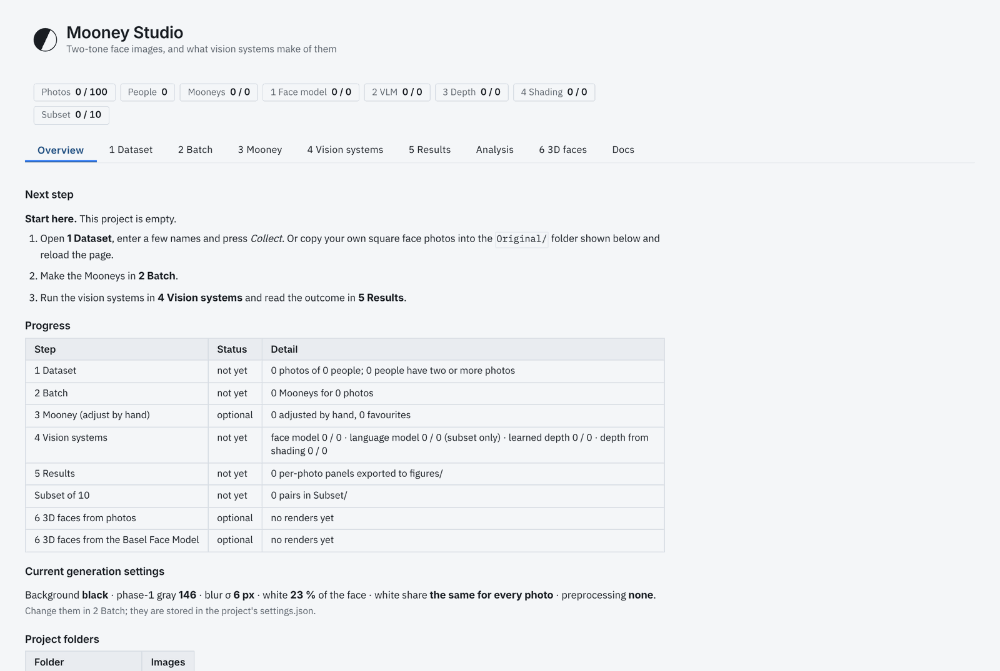
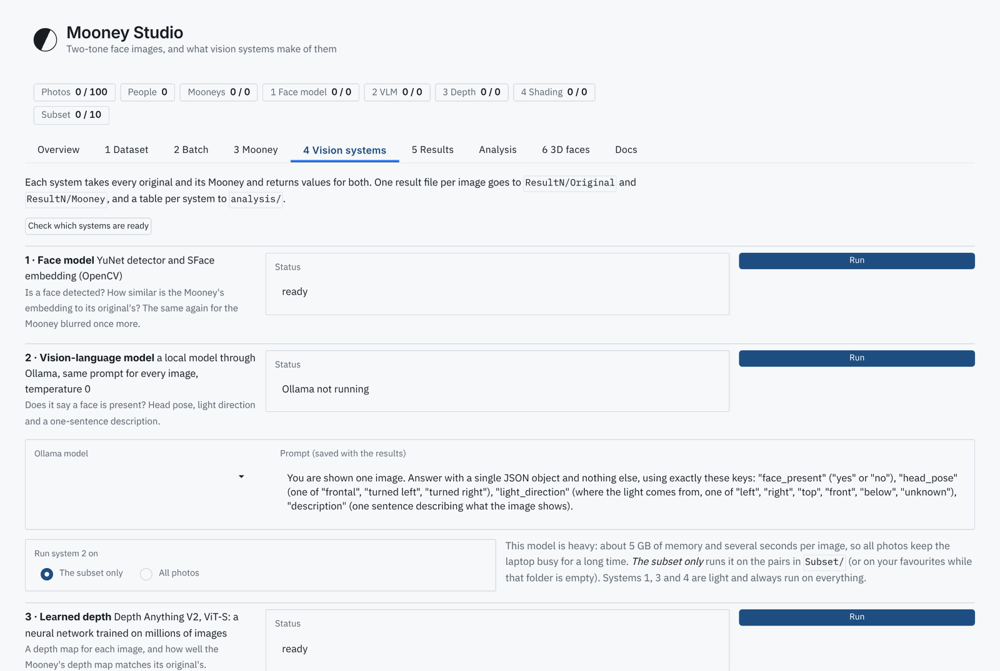

# Mooney Studio

A workbench for two-tone "Mooney" face images. It turns face photos into Mooney images with controlled
blur and white share, runs several vision systems on each photo and on its Mooney, and compares what they
return. The same experiment can be repeated on rendered 3D faces, where the light and the depth of every
pixel are known.

Everything runs on a laptop. No GPU and no account are needed.



## Quick start

```
git clone https://github.com/<your-account>/mooney-studio.git
cd mooney-studio
./setup.sh
./run.sh
```

Then open http://127.0.0.1:7860 (the address is also printed in the terminal).

`setup.sh` creates a conda environment called `mooney` if conda is installed, otherwise a virtual environment
in `.venv/`, and installs the packages in `requirements.txt`. It can be run again at any time;
`./setup.sh --venv` forces the virtual environment.

### Requirements

- macOS or Linux.
- Python 3.11, 3.12 or 3.13 (the setup was tested on these three).
- About 3 GB of free disk space for the packages and the model files. The model files (about 300 MB) are
  downloaded the first time a step needs them.
- Optional, for vision system 2: [Ollama](https://ollama.com) with a vision model
  (`ollama serve`, then `ollama pull llava:7b`). It needs about 5 GB of memory.
- Optional, for invented 3D faces: the Basel Face Model 2019 (see below).

By hand, without the two scripts:

```
python3 -m venv .venv
source .venv/bin/activate
pip install -r requirements.txt
python app.py
```

## Where your data goes

Nothing of yours is written into the code folder. Photos, Mooneys, results and saved runs go to the
**working folder**, which is `~/MooneyStudio` unless you choose another one:

```
~/MooneyStudio/
  project/     photos, Mooneys, results, settings
  runs/        saved runs
  notes/       optional: your own Markdown notes, shown in a Notes tab
```

To choose another working folder:

- in the app: **Overview**, *Working folder*, *Use this folder*, then restart the app;
- for one start only: `./run.sh --work ~/some/folder`;
- or set `WORK_DIR` in `config.json`, or the environment variable `MOONEY_WORK`.

Switching does not move anything: each working folder has its own project.

## The tabs

| Tab | What it does |
|---|---|
| Overview | where the project stands, what to do next, where the data is kept |
| 1 Dataset | collect openly licensed portraits from Wikimedia Commons, review them, remove bad ones |
| 2 Batch | one Mooney per photo with the same settings |
| 3 Mooney | adjust single photos by hand, mark favourites |
| 4 Vision systems | face model, vision-language model, learned depth, depth from shading |
| 5 Results | summary table, figure, per-photo viewer; save the run under a name |
| Analysis | results by properties of the photos; compare saved runs |
| 6 3D faces | renders with known light and depth (from your photos or from the Basel Face Model), their Mooneys, the systems against the truth, comparison of the stimulus sets |
| Notes | your own Markdown notes from the working folder (only if there are any) |
| Docs | the manual |



The manual is in [`docs/MANUAL.md`](docs/MANUAL.md). For every value the vision systems produce,
[`docs/VISION_SYSTEMS.md`](docs/VISION_SYSTEMS.md) says whether it is model output, one of the tool's
settings, or calculated by the tool.

## Layout of a project

```
project/
  Original/            512 px crops of the photos
  Mooney/              one PNG per photo
  Subset/Original, Subset/Mooney    the pairs you picked as the best
  Result1..4/Original, /Mooney      one file per image and vision system
  Raw/                 uncropped photos
  analysis/            one table per system, and the settings each system ran with
  figures/             exported tables, figures and panels
  dataset.csv          licence, author and source page of every photo
  params.csv           the values used for every Mooney
  settings.json        saved defaults
  3D/, 3D_basel/       the 3D experiments: the same layout again, plus truth/
```

## Settings

All defaults are in `config.py`, one line each with a short explanation. To change some without editing the
code, copy `config.example.json` to `config.json` and keep only the lines you need. `python config.py` prints
every setting with its current value. `config.json` is ignored by Git.

Environment variables override both: `MOONEY_WORK` (working folder), `MOONEY_PROJECT` and `MOONEY_RUNS` (the
two folders separately), `OLLAMA_HOST`, and for the address of the app `MOONEY_HOST`, `MOONEY_PORT`,
`MOONEY_SHARE`, `MOONEY_USER`, `MOONEY_PASSWORD`.

**Reaching the app from another computer.** By default it listens on this computer only. To open it up, set
the address and a login:

```
MOONEY_HOST=0.0.0.0 MOONEY_PORT=7860 MOONEY_USER=me MOONEY_PASSWORD=choose-one ./run.sh
```

The login is a single shared password, and the app can write and delete files in its working folder. Do not
put it on the open internet without the login.

## Optional: the Basel Face Model

The *6 3D faces* tab can draw invented faces from the Basel Face Model 2019. **The model is not included in
this repository.** It is free for non-commercial research after registration, and it may not be
redistributed, so everyone has to get their own copy:

1. Register at <https://faces.dmi.unibas.ch/bfm/bfm2019.html> and download `model2019_fullHead.h5` (whole
   head) and, if you like, `model2019_face12.h5` (face only).
2. Put the files into `models/` next to the code.

`*.h5` and `models/` are in `.gitignore`. Keep it that way: never commit or share the files or your download
links. Without the model the rest of the app works as before, and the tab says what is missing.

## Data and licences

- **Photos are never part of this repository.** Each collected photo keeps its own licence. Licence, author
  and source page of every photo are recorded in `dataset.csv` in your project; give credit from that file
  when you show or share a photo.
- **Model files are not part of this repository.** They are downloaded on first use from their publishers
  and keep their own licences (see Credits).
- **The code** is under the MIT licence, see [`LICENSE`](LICENSE).

## Credits

Mooney Studio builds on the work of others. Each of these has its own licence; check it before you use the
tool beyond research.

| Used for | Model or method | Source |
|---|---|---|
| Face detection | YuNet | [OpenCV Zoo](https://github.com/opencv/opencv_zoo/tree/main/models/face_detection_yunet) |
| Face embedding | SFace | [OpenCV Zoo](https://github.com/opencv/opencv_zoo/tree/main/models/face_recognition_sface) |
| Learned depth | Depth Anything V2, ViT-S | [Depth Anything V2](https://github.com/DepthAnything/Depth-Anything-V2), ONNX export from [Depth-Anything-ONNX](https://github.com/fabio-sim/Depth-Anything-ONNX) |
| Background separation | U²-Net through rembg | [U²-Net](https://github.com/xuebinqin/U-2-Net), [rembg](https://github.com/danielgatis/rembg) |
| 3D face mesh | MediaPipe Face Landmarker | [MediaPipe](https://ai.google.dev/edge/mediapipe/solutions/vision/face_landmarker) |
| Depth from shading | Tsai & Shah (1994), *Shape from shading using linear approximation*, Image and Vision Computing 12(8) | [doi:10.1016/0262-8856(94)90002-7](https://doi.org/10.1016/0262-8856(94)90002-7) |
| Invented 3D faces | Basel Face Model 2019 (Gerig et al., *Morphable Face Models: An Open Framework*, FG 2018) | [University of Basel](https://faces.dmi.unibas.ch/bfm/bfm2019.html) |
| Vision-language model | any vision model served by Ollama | [Ollama](https://ollama.com) |
| Photos | Wikimedia Commons, open licences only | [Wikimedia Commons](https://commons.wikimedia.org) |
| Interface | Gradio | [Gradio](https://www.gradio.app) |

The two-tone face images are named after Craig Mooney, who introduced them in 1957.

## Author

Akbar Hamidov
